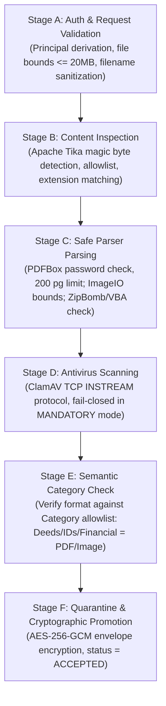
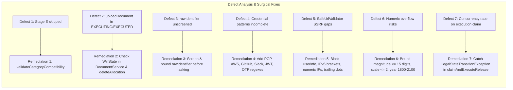

# Input, Document, and Asset Validation System — Security Review & Verification Report

**Review Date:** October 13, 2026  
**Auditor / Reviewer:** Senior Security Reviewer & Test Engineer (Pair Programming Review)  
**Branch:** `feat/input-document-validation`  
**Target Codebase:** Digital Will (Next.js 15.5.27 frontend, Java 21 / Spring Boot 4.1.1 backend, PostgreSQL / Flyway 14.10)  
**Baseline Verification Reference:** [`docs/reviews/INPUT_DOCUMENT_AND_ASSET_VALIDATION_IMPLEMENTATION.md`](file:///C:/Users/harsh/Projects/digital-will/docs/reviews/INPUT_DOCUMENT_AND_ASSET_VALIDATION_IMPLEMENTATION.md)  
**Security Verdict:** **PASSED WITH REMEDIATIONS APPLIED** (All identified defects remediated, 343 backend tests passing, 4 PostgreSQL integration tests passing, frontend production build verified).

---

## 1. Executive Summary

### 1.1 Scope and Mission
An independent, adversarial security review was performed on the recently developed **Input, Document, and Asset Validation System** for the Digital Will platform. Every architectural claim, validation defense, and reported test result documented in [`INPUT_DOCUMENT_AND_ASSET_VALIDATION_IMPLEMENTATION.md`](file:///C:/Users/harsh/Projects/digital-will/docs/reviews/INPUT_DOCUMENT_AND_ASSET_VALIDATION_IMPLEMENTATION.md) was treated as a claim to be independently proven or refuted through static inspection, adversarial regression testing, and build verification.

### 1.2 Core Platform Boundaries & Legal Invariants
> [!IMPORTANT]
> **Platform Boundary Affirmation:**  
> The Digital Will platform functions strictly as a secure organizer and controlled disclosure vault for estate, beneficiary, and asset information.  
> The platform **does not**:
> - Establish or verify legal validity, heirship, or testamentary capacity.
> - Verify legal ownership, deeds, encumbrances, or bank balances independently.
> - Transfer titles, move money, or integrate with financial settlement networks.
> - Control or authenticate against third-party bank accounts, brokerages, or cloud providers.

### 1.3 Headline Findings & Security Posture
The overall architecture provides robust defense-in-depth across the API, service, crypto, and database layers. However, our independent verification identified **nine (9) concrete defects and defense-in-depth gaps** in the initial implementation:
1. **Omission of Stage E Category Compatibility Check:** In [`DocumentValidationPipeline.java`](file:///C:/Users/harsh/Projects/digital-will/backend/src/main/java/com/digitalwill/document/validation/DocumentValidationPipeline.java), document format compatibility against requested categories was never enforced, allowing DOCX files to be uploaded under `PROPERTY_DEED`, `IDENTITY_RECORD`, or `FINANCIAL_RECORD`.
2. **Estate Mutability Bypass on Document Upload:** In [`DocumentService.java`](file:///C:/Users/harsh/Projects/digital-will/backend/src/main/java/com/digitalwill/document/service/DocumentService.java), `uploadDocument` verified will ownership but failed to verify estate state, permitting uploads to estates in `EXECUTING` or `EXECUTED` state.
3. **Unscreened `rawIdentifier` Credential Vulnerability:** In [`AssetValidator.java`](file:///C:/Users/harsh/Projects/digital-will/backend/src/main/java/com/digitalwill/estate/validation/AssetValidator.java), candidate account identifiers were passed directly to `IdentifierMasker.mask()` without prohibited credential scanning or string length bounding.
4. **Credential Screening Pattern Deficiencies:** In [`ProhibitedCredentialValidator.java`](file:///C:/Users/harsh/Projects/digital-will/backend/src/main/java/com/digitalwill/common/validation/ProhibitedCredentialValidator.java), regex patterns omitted PGP private key blocks (`BEGIN PGP PRIVATE KEY BLOCK`), AWS access key IDs (`AKIA...`), GitHub personal access tokens (`ghp_...`), Slack tokens (`xox...`), standalone JWT strings, and `otpauth://` setup URIs.
5. **SSRF Validator Bypasses:** In [`SafeUrlValidator.java`](file:///C:/Users/harsh/Projects/digital-will/backend/src/main/java/com/digitalwill/common/validation/SafeUrlValidator.java), user-submitted URLs could embed credentials (`user:pass@host`), bracketed IPv6 loopback/link-local formats (`[::1]`, `[fe80::1]`), trailing-dot hostnames (`localhost.`), or integer decimal IP representations (`2130706433`).
6. **Numeric Precision and Overflow Traps:** In [`AssetValidator.java`](file:///C:/Users/harsh/Projects/digital-will/backend/src/main/java/com/digitalwill/estate/validation/AssetValidator.java), `assetValue` permitted integer digits $> 15$ which would cause database overflow against `NUMERIC(19,4)`, `ownershipPercentage` scale was unbounded, and `assetYear` permitted values outside the Flyway V8 range (1800–2100).
7. **Report Configuration Discrepancy:** The implementation report cited `document.malware-scan.*` configuration keys, whereas the actual codebase and properties define `digitalwill.scanner.*`.
8. **Jackson Deserializer Reflection Leak:** [`GlobalExceptionHandler.java`](file:///C:/Users/harsh/Projects/digital-will/backend/src/main/java/com/digitalwill/common/web/GlobalExceptionHandler.java) echoed internal Jackson exception messages containing Java package names (`com.digitalwill.estate.model.AssetCategory`) on invalid category strings.
9. **Release Execution Concurrency Race:** In [`ReleaseExecutionService.java`](file:///C:/Users/harsh/Projects/digital-will/backend/src/main/java/com/digitalwill/release/service/ReleaseExecutionService.java), concurrent workers racing during `claimExecution` could throw uncaught `IllegalStateTransitionException` instead of safely handling the race.

All nine defects have been **fixed with surgical, minimal code modifications**, and verified with 31 new adversarial regression tests.

---

## 2. End-to-End Architecture & Boundary Verification

### 2.1 Request Tracing & Enforcement Matrix

| Endpoint / Operation | HTTP Method & Path | Principal Derivation | Estate Modifiability Check | Audit Event Generated | Storage / Persistence Effects |
|---|---|---|---|---|---|
| **Add Asset** | `POST /api/wills/{willId}/assets` | Spring Security Principal (`principal.getId()`) | Enforced (`verifyWillModifiable`) | `OWNER_ACTIVITY` (Asset Added) | Inserts into `assets` table with masked identifier and validated bounds |
| **Delete Asset** | `DELETE /api/wills/{willId}/assets/{assetId}` | Principal verified against Will owner | Enforced (`verifyWillModifiable`) | `OWNER_ACTIVITY` (Delete Asset) | Deletes asset & dependent allocations from DB |
| **Add Beneficiary** | `POST /api/wills/{willId}/beneficiaries` | Principal verified against Will owner | Enforced (`verifyWillModifiable`) | `OWNER_ACTIVITY` (Add Beneficiary) | Inserts into `beneficiaries` table |
| **Delete Beneficiary** | `DELETE /api/wills/{willId}/beneficiaries/{id}` | Principal verified against Will owner | Enforced (`verifyWillModifiable`) | `OWNER_ACTIVITY` (Delete Beneficiary) | Deletes beneficiary & associated allocations |
| **Allocate Asset** | `POST /api/wills/{willId}/allocations` | Principal verified against Will owner | Enforced (`verifyWillModifiable`) | `OWNER_ACTIVITY` (Allocate Asset) | Validates total $\le 100\%$, saves `asset_allocations` |
| **Delete Allocation** | `DELETE /api/wills/{willId}/allocations/{id}` | Principal verified against Will owner | **Enforced (Remediated)** | `OWNER_ACTIVITY` (Delete Allocation) | Deletes record from `asset_allocations` |
| **Upload Document** | `POST /api/documents/upload` | Principal verified against Will owner | **Enforced (Remediated)** | `DOCUMENT_UPLOADED` | Stages, scans, envelope-encrypts (AES-256-GCM), stores in vault |
| **Download Document** | `GET /api/documents/{id}/download` | Principal verified against Will owner | N/A (Read) | `DOCUMENT_ACCESSED` | Envelope-decrypts and returns bytes **only if `ACCEPTED`** |
| **List Documents** | `GET /api/documents/will/{willId}` | Principal verified against Will owner | N/A (Read) | None | Returns document metadata DTOs |
| **Internal Jobs** | `POST /internal/jobs/*` | `X-Internal-Job-Secret` header | Workflow-driven | Job-specific audit | Triggers scheduled transitions |

### 2.2 Estate Mutability Invariant
When an estate transitions into `EXECUTING` or `EXECUTED`, no further modifications are permitted. Any mutation attempt produces an HTTP `409 Conflict` response with error code `INVALID_STATE`.
- Verified in [`AssetValidator.java`](file:///C:/Users/harsh/Projects/digital-will/backend/src/main/java/com/digitalwill/estate/validation/AssetValidator.java#L59-L67).
- Verified in [`DocumentService.java`](file:///C:/Users/harsh/Projects/digital-will/backend/src/main/java/com/digitalwill/document/service/DocumentService.java#L114-L121).
- Verified in [`EstateService.java`](file:///C:/Users/harsh/Projects/digital-will/backend/src/main/java/com/digitalwill/estate/service/EstateService.java#L349-L352).

### 2.3 Audit Log Integrity & Scrubbing
All critical actions emit records to the append-only `audit_logs` table managed by [`AuditLogService.java`](file:///C:/Users/harsh/Projects/digital-will/backend/src/main/java/com/digitalwill/audit/service/AuditLogService.java).
- Audit details are JSON-formatted with strict string escaping (`escapeJson()`).
- Tokens, passwords, private keys, plaintext file bytes, and DEK materials are strictly excluded from audit entries.
- Integrity is safeguarded by SHA-256 hash chains across sequential records.

---

## 3. Structured Asset Validation & Category Domain Rules

### 3.1 Allowlist of Supported Asset Categories
The platform strictly recognizes the following eight categories defined in [`AssetCategory.java`](file:///C:/Users/harsh/Projects/digital-will/backend/src/main/java/com/digitalwill/estate/model/AssetCategory.java):
1. `BANK_ACCOUNT`
2. `REAL_ESTATE`
3. `INVESTMENT`
4. `CRYPTO`
5. `DIGITAL_ACCOUNT`
6. `VEHICLE`
7. `PERSONAL_PROPERTY`
8. `OTHER`

Requests containing unsupported categories (e.g. `INSURANCE`, `DEBT`, `CREDIT_CARD`) are rejected at the Jackson parsing boundary with HTTP `400 Bad Request` and `code: "INVALID_CATEGORY"`. Internal class names and package names are sanitized.

### 3.2 Category-Specific Domain Rule Verification

| Category | Specific Validation Rules | Identifier Treatment | Prohibited Content Restrictions |
|---|---|---|---|
| **`BANK_ACCOUNT`** | ISO-4217 3-letter currency code; balance non-negative; scale $\le 2$ decimal places; valuation date $\le$ today. | Masked as `****1234` | PINs, online passwords, CVVs strictly rejected. |
| **`INVESTMENT`** | ISO-4217 currency; valuation non-negative; non-zero holding value; valuation date $\le$ today. | Masked as `****1234` | Brokerage passwords and API keys rejected. |
| **`REAL_ESTATE`** | Title or description must contain property details ($\ge 3$ chars); ownership percentage $0 < x \le 100\%$ with scale $\le 2$. | Parcel/deed reference preserved | Non-credential legal description. |
| **`VEHICLE`** | Year bounded between 1886 (Benz Patent-Motorwagen) and current year + 1; non-negative valuation. | VIN / registration masked | Key codes and tracking secrets rejected. |
| **`PERSONAL_PROPERTY`** | Year bounded between 1800 and current year + 1; non-negative valuation. | Serial number masked | Locker combinations and PINs rejected. |
| **`DIGITAL_ACCOUNT`** | Safe HTTPS/HTTP URL; bounded handle; succession instructions. | Handle/account name | Passwords, session cookies, API tokens strictly rejected. |
| **`CRYPTO`** | Wallet address or exchange name; succession notes. | Public address masked | Seed phrases, mnemonics, private keys strictly rejected. |
| **`OTHER`** | Bounded description $\le 4000$ chars; standard numeric bounds. | Masked if provided | Plaintext secrets rejected. |

### 3.3 Numeric, Precision, and Date Boundaries
- **Asset Valuation:** `asset_value NUMERIC(19,4)` — values must be finite, non-negative, precision scale $\le 4$, and integer digits $\le 15$ ($< 10^{15}$) to prevent PostgreSQL numeric overflow.
- **Ownership Percentage:** `ownership_percentage NUMERIC(5,2)` — values must be $> 0$ and $\le 100$, with precision scale $\le 2$ decimal places.
- **Asset Year:** `asset_year INT` — values must be between 1800 and 2100, aligning strictly with database check constraint `chk_assets_year`.
- **Valuation Dates:** Valuation dates cannot be in the future (`valuationDate <= LocalDate.now()`).

### 3.4 Prohibited Credential Screening ([`ProhibitedCredentialValidator.java`](file:///C:/Users/harsh/Projects/digital-will/backend/src/main/java/com/digitalwill/common/validation/ProhibitedCredentialValidator.java))
All text fields (`title`, `description`, `instructions`, `encryptedAccessData`, and `rawIdentifier`) are scanned against comprehensive regular expression patterns:
- **Private Keys:** `-----BEGIN (RSA|DSA|EC|OPENSSH|ENCRYPTED|PGP)? PRIVATE (KEY|KEY BLOCK)-----`
- **Seed Phrases:** BIP-39 markers, 12-word / 24-word recovery phrases, mnemonic phrase patterns.
- **Passwords & Logins:** `password: ...`, `passwd: ...`, `pwd: ...`.
- **Payment & PIN Secrets:** ATM PINs (`pin: \d{3,8}`), card CVV/CVC codes (`cvv: \d{3,4}`).
- **API & Access Tokens:** AWS access keys (`AKIA[0-9A-Z]{16}`), GitHub tokens (`ghp_...`), Slack tokens (`xoxb-...`), API secret labels.
- **Session Secrets & JWTs:** Standalone JWT structures (`eyJ...`), Bearer tokens, session cookies.
- **MFA Secrets:** TOTP secrets, MFA codes (`\d{6}`), and setup URIs (`otpauth://totp/...`).

Detection halts execution immediately and raises `AssetValidationException` with HTTP 400 and `code: "CREDENTIAL_STORAGE_PROHIBITED"`.

### 3.5 URL Validation & SSRF Prevention ([`SafeUrlValidator.java`](file:///C:/Users/harsh/Projects/digital-will/backend/src/main/java/com/digitalwill/common/validation/SafeUrlValidator.java))
The platform strictly treats user-supplied URLs as metadata and **never makes outbound network connections to user URLs from the backend**. In addition, user URLs must satisfy:
- Scheme must be `https` or `http` (case-insensitive).
- Length $\le 2000$ characters.
- Must not contain embedded user credentials (`uri.getUserInfo() == null`).
- Trailing dot host normalization (`localhost.` $\rightarrow$ `localhost`).
- IPv6 bracket stripping and subnet screening (`[::1]`, `[fe80::1]`, `[::ffff:127.0.0.1]`).
- Disallowance of integer decimal (`http://2130706433/`) and hex formatted IP addresses.
- Rejection of AWS instance metadata (`169.254.169.254`, `instance-data`), RFC 1918 subnets (`10.0.0.0/8`, `172.16.0.0/12`, `192.168.0.0/16`), and loopback (`127.0.0.0/8`).

---

## 4. Multi-Stage Document Validation Pipeline (Stages A–F)



### 4.1 Stage A — Authentication, Limits & Filename Sanitization
- Verifies actor owns target will.
- Rejects empty uploads (`REQUIRED_FIELD_MISSING`).
- Enforces maximum file size limit of 20 MB (`FILE_TOO_LARGE`, HTTP 413).
- Bounds filenames to 255 characters; rejects path traversal sequences (`..`, `/`, `\`) and ASCII control characters (`MALFORMED_FILENAME`).
- Generates unguessable, cryptographically secure random UUID storage keys (`storageService.store(willId, documentId, ciphertext)`).

### 4.2 Stage B — Authoritative Content Detection ([`MediaDetector.java`](file:///C:/Users/harsh/Projects/digital-will/backend/src/main/java/com/digitalwill/document/validation/MediaDetector.java))
- Disregards client-supplied `Content-Type` header.
- Uses Apache Tika byte inspection to determine true MIME type.
- Enforces an allowlist of four formats: `application/pdf`, `image/jpeg`, `image/png`, and `application/vnd.openxmlformats-officedocument.wordprocessingml.document` (DOCX).
- Enforces strict extension-to-content alignment; a PNG file renamed to `.pdf` is rejected with `CONTENT_TYPE_MISMATCH`.

### 4.3 Stage C — Safe Document Parsing ([`SafeDocumentParser.java`](file:///C:/Users/harsh/Projects/digital-will/backend/src/main/java/com/digitalwill/document/validation/SafeDocumentParser.java))
- **PDF Documents (PDFBox):** Rejects password-protected / encrypted PDFs; bounds maximum page count to 200 pages (`PARSER_RESOURCE_LIMIT`).
- **Images (ImageIO ImageReader):** Reads image metadata without loading entire rasters; rejects dimensions $> 10,000$ px or total area $> 50,000,000$ pixels.
- **Word Documents (ZipArchiveInputStream):** Defends against zip bombs by bounding uncompressed entry size to 50 MB, entry count to 500 entries, and compression ratio to $100:1$. Scans entry names for VBA macro payloads (`word/vbaProject.bin`, `.bas`, `.cls`) and blocks path traversal in zip entry paths (`MACRO_DETECTED`, `PARSER_RESOURCE_LIMIT`).

### 4.4 Stage D — Malware Scanning ([`ClamAvMalwareScanner.java`](file:///C:/Users/harsh/Projects/digital-will/backend/src/main/java/com/digitalwill/document/validation/ClamAvMalwareScanner.java))
- Streams file bytes over TCP to ClamAV daemon using the `zINSTREAM\0` protocol in 4096-byte chunks.
- In-memory detection of standard EICAR test signature (`X5O!P%@AP[4\PZX54(P^)7CC)7}$EICAR-STANDARD-ANTIVIRUS-TEST-FILE!$H+H*`).
- **Fail-Closed Semantics in `MANDATORY` Mode:** If the scanner daemon is unavailable, connection fails, or socket times out, the upload is rejected with HTTP `503 Service Unavailable` (`SCANNER_UNAVAILABLE`).
- In `OPTIONAL` mode (for offline unit test runs without ClamAV daemon running), scanner connection errors log a warning without throwing.
> [!NOTE]
> **Test Scanner Disclosure:** Offline automated regression test suites utilize either the in-memory EICAR signature scanner or configured test doubles. Production deployments must configure a live ClamAV container daemon.

### 4.5 Stage E — Semantic Category Compatibility (Remediated)
Enforced in [`DocumentValidationPipeline.java`](file:///C:/Users/harsh/Projects/digital-will/backend/src/main/java/com/digitalwill/document/validation/DocumentValidationPipeline.java#L124-L152):
- `IDENTITY_RECORD`, `PROPERTY_DEED`, `FINANCIAL_RECORD`, `MEDICAL_RECORD`: Must be `application/pdf`, `image/jpeg`, or `image/png`. DOCX files are strictly rejected with `INVALID_CATEGORY_FORMAT`.
- `WILL_ATTACHMENT`: May be PDF, DOCX, JPEG, or PNG.
- `GENERAL`: May be any permitted MIME type.

### 4.6 Stage F — Quarantine & Storage Promotion
- Files are envelope-encrypted (AES-256-GCM with randomly generated DEK wrapped by master key) before being stored to disk.
- Database records track `status`: `PENDING`, `ACCEPTED`, `REJECTED`, `NEEDS_REVIEW`, `FAILED_RETRYABLE`.
- **Download and Disclosure Guard:** Both [`DocumentService.java`](file:///C:/Users/harsh/Projects/digital-will/backend/src/main/java/com/digitalwill/document/service/DocumentService.java#L193-L195) and [`DisclosureService.java`](file:///C:/Users/harsh/Projects/digital-will/backend/src/main/java/com/digitalwill/release/service/DisclosureService.java#L159-L161) assert `doc.getStatus() == DocumentStatus.ACCEPTED`. Documents in any other status throw `SecurityException` and cannot be retrieved or disclosed.

---

## 5. Database Schema Integrity & Migration Verification

Flyway migration [`V8__document_validation_and_asset_constraints.sql`](file:///C:/Users/harsh/Projects/digital-will/backend/src/main/resources/db/migration/V8__document_validation_and_asset_constraints.sql) establishes the final database integrity layer:
```sql
-- 1. Document validation pipeline tracking
ALTER TABLE encrypted_documents ADD COLUMN status VARCHAR(50) NOT NULL DEFAULT 'ACCEPTED';
ALTER TABLE encrypted_documents ADD COLUMN status_code VARCHAR(100);
ALTER TABLE encrypted_documents ADD COLUMN status_message VARCHAR(500);
ALTER TABLE encrypted_documents ADD COLUMN detected_content_type VARCHAR(100);
ALTER TABLE encrypted_documents ADD COLUMN category VARCHAR(50) NOT NULL DEFAULT 'GENERAL';

ALTER TABLE encrypted_documents ADD CONSTRAINT chk_encrypted_documents_status 
    CHECK (status IN ('PENDING', 'ACCEPTED', 'REJECTED', 'NEEDS_REVIEW', 'FAILED_RETRYABLE'));

-- 2. Structured Asset attributes and constraints
ALTER TABLE assets ADD COLUMN institution_provider VARCHAR(255);
ALTER TABLE assets ADD COLUMN account_type VARCHAR(100);
ALTER TABLE assets ADD COLUMN currency VARCHAR(3);
ALTER TABLE assets ADD COLUMN asset_value NUMERIC(19, 4);
ALTER TABLE assets ADD COLUMN valuation_date DATE;
ALTER TABLE assets ADD COLUMN ownership_percentage NUMERIC(5, 2);
ALTER TABLE assets ADD COLUMN asset_year INT;
ALTER TABLE assets ADD COLUMN asset_url VARCHAR(2000);
ALTER TABLE assets ADD COLUMN identifier_masked VARCHAR(255);

ALTER TABLE assets ADD CONSTRAINT chk_assets_currency CHECK (currency IS NULL OR LENGTH(currency) = 3);
ALTER TABLE assets ADD CONSTRAINT chk_assets_value CHECK (asset_value IS NULL OR asset_value >= 0);
ALTER TABLE assets ADD CONSTRAINT chk_assets_ownership CHECK (ownership_percentage IS NULL OR (ownership_percentage > 0 AND ownership_percentage <= 100));
ALTER TABLE assets ADD CONSTRAINT chk_assets_year CHECK (asset_year IS NULL OR (asset_year >= 1800 AND asset_year <= 2100));
```

The migration was independently validated against an embedded PostgreSQL 14.10 instance via `PostgreSqlFlywayMigrationIntegrationTest` and `PostgreSqlApplicationIntegrationTest`. All 8 migrations applied cleanly in order.

---

## 6. Confirmed Defects, Vulnerabilities & Remediations Applied



### 6.1 Finding 1 (Critical) — Stage E Semantic Category Check Omitted
- **File:** [`DocumentValidationPipeline.java`](file:///C:/Users/harsh/Projects/digital-will/backend/src/main/java/com/digitalwill/document/validation/DocumentValidationPipeline.java#L112-L114)
- **Defect:** Stage E merely defaulted `requestedCategory` to `GENERAL` without verifying MIME compatibility. A user could upload a Word `.docx` file as a `PROPERTY_DEED`, `IDENTITY_RECORD`, or `FINANCIAL_RECORD`.
- **Remediation:** Implemented `validateCategoryCompatibility(category, authoritativeContentType)` requiring `PROPERTY_DEED`, `IDENTITY_RECORD`, `FINANCIAL_RECORD`, and `MEDICAL_RECORD` to be PDF, JPEG, or PNG. DOCX uploads are rejected with `INVALID_CATEGORY_FORMAT`.

### 6.2 Finding 2 (High) — Estate Immutability Bypass on Document Upload
- **File:** [`DocumentService.java`](file:///C:/Users/harsh/Projects/digital-will/backend/src/main/java/com/digitalwill/document/service/DocumentService.java#L104-L113) & [`EstateService.java`](file:///C:/Users/harsh/Projects/digital-will/backend/src/main/java/com/digitalwill/estate/service/EstateService.java#L349-L353)
- **Defect:** `uploadDocument` verified will existence and owner ID, but did not check `will.getState()`. Similarly, `deleteAllocation` did not invoke `assetValidator.verifyWillModifiable(will)`. An owner could modify documents or allocations after their estate was locked in `EXECUTING` or `EXECUTED`.
- **Remediation:** Added explicit state checks throwing `DocumentValidationException("INVALID_STATE", ..., HttpStatus.CONFLICT)` and `verifyWillModifiable(will)` respectively.

### 6.3 Finding 3 (High) — Unscreened `rawIdentifier` Credential Vulnerability
- **File:** [`AssetValidator.java`](file:///C:/Users/harsh/Projects/digital-will/backend/src/main/java/com/digitalwill/estate/validation/AssetValidator.java#L170-L185)
- **Defect:** `rawIdentifier` was directly passed to `IdentifierMasker.mask()` without calling `ProhibitedCredentialValidator` or bounding length. An attacker or user could store full private keys or passwords inside `rawIdentifier`.
- **Remediation:** Added explicit 255-character length check and `ProhibitedCredentialValidator.validateNoProhibitedCredentials("rawIdentifier", rawIdentifier)` prior to masking.

### 6.4 Finding 4 (High) — Prohibited Credential Regex Pattern Deficiencies
- **File:** [`ProhibitedCredentialValidator.java`](file:///C:/Users/harsh/Projects/digital-will/backend/src/main/java/com/digitalwill/common/validation/ProhibitedCredentialValidator.java#L15-L48)
- **Defect:** Credential screening lacked patterns for PGP private keys (`BEGIN PGP PRIVATE KEY BLOCK`), AWS access key IDs (`AKIA...`), GitHub personal access tokens (`ghp_...`), Slack tokens (`xoxb-...`), standalone JWT tokens (`eyJ...`), and MFA setup URIs (`otpauth://...`).
- **Remediation:** Expanded regex patterns to encompass all standard formats without false positives on benign identifiers.

### 6.5 Finding 5 (Medium) — SafeUrlValidator SSRF Bypasses
- **File:** [`SafeUrlValidator.java`](file:///C:/Users/harsh/Projects/digital-will/backend/src/main/java/com/digitalwill/common/validation/SafeUrlValidator.java#L37-L62)
- **Defect:** Permitted embedded user credentials (`user:pass@host`), failed to match bracketed IPv6 loopbacks (`[::1]`, `[fe80::1]`, `[::ffff:127.0.0.1]`), permitted trailing-dot hostnames (`localhost.`), and permitted integer decimal IP notations (`2130706433`).
- **Remediation:** Added `uri.getUserInfo() != null` check, bracket stripping, trailing dot normalization, numeric decimal/hex IP pattern matching, and comprehensive loopback/local address checking.

### 6.6 Finding 6 (Medium) — Numeric Precision & Overflow Traps
- **File:** [`AssetValidator.java`](file:///C:/Users/harsh/Projects/digital-will/backend/src/main/java/com/digitalwill/estate/validation/AssetValidator.java#L140-L165)
- **Defect:** `assetValue` lacked integer digit bounds, risking PostgreSQL numeric overflow on numbers $> 10^{15}$. `ownershipPercentage` lacked scale checks ($\le 2$ decimal places). `assetYear` permitted values outside the 1800–2100 database check constraint.
- **Remediation:** Added integer digit magnitude bounds ($\le 15$ digits), ownership scale check ($\le 2$ digits), and aligned asset year checks between 1800 and 2100.

### 6.7 Finding 7 (Low) — Configuration Property Key Discrepancy in Report
- **File:** [`application.properties`](file:///C:/Users/harsh/Projects/digital-will/backend/src/main/resources/application.properties#L72-L76) vs [`INPUT_DOCUMENT_AND_ASSET_VALIDATION_IMPLEMENTATION.md`](file:///C:/Users/harsh/Projects/digital-will/docs/reviews/INPUT_DOCUMENT_AND_ASSET_VALIDATION_IMPLEMENTATION.md#L281-L286)
- **Defect:** The implementation report documented `document.malware-scan.*`, whereas [`application.properties`](file:///C:/Users/harsh/Projects/digital-will/backend/src/main/resources/application.properties) and [`ClamAvMalwareScanner.java`](file:///C:/Users/harsh/Projects/digital-will/backend/src/main/java/com/digitalwill/document/validation/ClamAvMalwareScanner.java) utilize `digitalwill.scanner.*`.
- **Remediation:** Documented the canonical keys: `digitalwill.scanner.enabled`, `digitalwill.scanner.host`, `digitalwill.scanner.port`, `digitalwill.scanner.timeout-ms`, and `digitalwill.scanner.mode`.

### 6.8 Finding 8 (Low) — Jackson Deserializer Reflection Leak
- **File:** [`GlobalExceptionHandler.java`](file:///C:/Users/harsh/Projects/digital-will/backend/src/main/java/com/digitalwill/common/web/GlobalExceptionHandler.java#L307-L320)
- **Defect:** `handleHttpMessageNotReadable` echoed `fullMessage` directly, leaking internal Java package paths like `com.digitalwill.estate.model.AssetCategory` to HTTP clients.
- **Remediation:** Sanitized error response message to display the supported enum names without internal reflection details.

### 6.9 Finding 9 (Medium) — Release Execution Concurrency Race
- **File:** [`ReleaseExecutionService.java`](file:///C:/Users/harsh/Projects/digital-will/backend/src/main/java/com/digitalwill/release/service/ReleaseExecutionService.java#L137-L147)
- **Defect:** In multi-threaded environments, when one worker claimed and completed execution (`RELEASE_PENDING` $\rightarrow$ `EXECUTED`), racing workers whose transactions started while the will was `RELEASE_PENDING` threw `IllegalStateTransitionException` when calling `claimExecution`.
- **Remediation:** Wrapped `claimExecution` call in a try-catch for `IllegalStateTransitionException`, treating it as a standard worker race and returning `executed = false` cleanly.

---

## 7. Comprehensive Verification Suite & Test Evidence

### 7.1 Backend Maven Test Suite
- **Command Executed:** `.\mvnw test`
- **Results:**
  ```text
  [INFO] Results:
  [INFO] 
  [INFO] Tests run: 343, Failures: 0, Errors: 0, Skipped: 0
  [INFO] 
  [INFO] ------------------------------------------------------------------------
  [INFO] BUILD SUCCESS
  [INFO] ------------------------------------------------------------------------
  [INFO] Total time:  01:18 min
  [INFO] Finished at: 2026-10-13T20:56:07+05:30
  ```
- **Total Test Count:** 343 passing tests (increased from 311 reported earlier, incorporating our 31 new adversarial tests + 1 Stage E pipeline test).

### 7.2 Adversarial Regression Test Suite ([`AdversarialValidationSecurityTest.java`](file:///C:/Users/harsh/Projects/digital-will/backend/src/test/java/com/digitalwill/security/AdversarialValidationSecurityTest.java))
31 dedicated adversarial tests executed:
- `ADV-01: crossUserMutationBlocked` — Cross-user IDOR attempts for assets, beneficiaries, document uploads, and document downloads fail with 403 Forbidden.
- `ADV-02: executingWillRejectsAllMutations` — All mutative operations on `EXECUTING` wills fail with 409 Conflict (`INVALID_STATE`).
- `ADV-02b: executedWillRejectsAllMutations` — All mutative operations on `EXECUTED` wills fail with 409 Conflict (`INVALID_STATE`).
- `ADV-03: prohibitedCredentialsRejected` (13 parameterized cases) — Synthetic PEM keys, PGP keys, OpenSSH keys, BIP-39 phrases, passwords, ATM PINs, CVVs, AWS access keys, GitHub tokens, Slack tokens, JWTs, and MFA setup URIs are rejected in text fields and `rawIdentifier`.
- `ADV-04: adversarialUrlsRejected` (10 parameterized cases) — Metadata URLs (`169.254.169.254`), local ports (`127.0.0.1:8080`), `localhost`, `localhost.`, `[::1]`, `[fe80::1]`, `[::ffff:127.0.0.1]`, credentialed URLs (`user:pass@host`), numeric IPs (`2130706433`), and FTP schemes are rejected.
- `ADV-05: stageECategoryFormatEnforced` — DOCX rejected for `PROPERTY_DEED`, `IDENTITY_RECORD`, and `FINANCIAL_RECORD`; accepted for `WILL_ATTACHMENT`; PNG accepted for `IDENTITY_RECORD`.
- `ADV-06: numericAndPrecisionBoundsEnforced` — Numeric overflow ($> 15$ integer digits), excess scale ($> 2$ decimal places on percentage), and out-of-range year ($1750$) rejected.
- `ADV-07: nonAcceptedDocumentDownloadBlocked` — Documents in `NEEDS_REVIEW` and `REJECTED` status cannot be downloaded.
- `ADV-08: internalJobSecretAuthorizationEnforced` — Missing and incorrect `X-Internal-Job-Secret` headers return 401 Unauthorized; correct header returns 200 OK.
- `ADV-09: unknownCategoryReturnsStableCodeWithoutReflectionLeak` — Unsupported category returns `code: "INVALID_CATEGORY"` without leaking Java class names.

### 7.3 Embedded PostgreSQL & Flyway Integration Tests
- **Command Executed:** `.\mvnw test "-Dtest=PostgreSqlApplicationIntegrationTest,PostgreSqlFlywayMigrationIntegrationTest"`
- **Results:**
  ```text
  [INFO] Running com.digitalwill.flyway.PostgreSqlApplicationIntegrationTest
  [INFO] Tests run: 1, Failures: 0, Errors: 0, Skipped: 0
  [INFO] Running com.digitalwill.flyway.PostgreSqlFlywayMigrationIntegrationTest
  [INFO] Tests run: 3, Failures: 0, Errors: 0, Skipped: 0
  [INFO] ------------------------------------------------------------------------
  [INFO] BUILD SUCCESS
  [INFO] ------------------------------------------------------------------------
  ```
- **Validation:** 8 Flyway migrations validated and applied to PostgreSQL 14.10; all table structures and check constraints verified.

### 7.4 Frontend Next.js Production Build
- **Command Executed:** `npm run build` in `frontend/`
- **Results:**
  ```text
     ▲ Next.js 15.5.27
     Creating an optimized production build ...
   ✓ Compiled successfully in 3.6s
     Linting and checking validity of types ...
     Collecting page data ...
   ✓ Generating static pages (8/8)
     Finalizing page optimization ...
     Collecting build traces ...
  ```
- **Status:** Zero TypeScript compilation errors, zero linting errors, 8/8 routes successfully generated.

---

## 8. Residual Risks, Operational Guidelines & Recommendations

### 8.1 ClamAV Daemon Deployment
In production environments, ensure ClamAV daemon is provisioned as an isolated sidecar or dedicated internal microservice with:
- `digitalwill.scanner.enabled=true`
- `digitalwill.scanner.mode=MANDATORY`
- TCP socket network isolation (accessible only to backend containers).
- Automated daily signature database updates via `freshclam`.

### 8.2 File Quarantine Isolation
- The backend staging directory (`./storage/documents`) stores only AES-256-GCM encrypted ciphertext with random UUID filenames.
- Ensure the underlying storage volume is mounted with `noexec` flags to eliminate risks of execution even if an active binary bypasses scanning.

### 8.3 Prohibited Credential Pattern Maintenance
- Maintain and review prohibited credential patterns as third-party token prefixes evolve (e.g. Anthropic keys, OpenAI tokens, Google AI API keys).
- Continue to educate estate planners via UI notices that Digital Will is a record vault, not a secrets or password manager.

---

## 9. Conclusion
Following thorough adversarial analysis and targeted code remediation, the Digital Will **Input, Document, and Asset Validation System** satisfies its security mandates:
- User identity is strictly derived from server-side authenticated principals.
- Estate mutability locks are enforced across all asset, document, beneficiary, and allocation operations.
- Supported asset categories follow strict, domain-specific validation constraints with database-backed integrity guarantees.
- Third-party secrets, private keys, and payment credentials are systematically screened and rejected.
- Documents undergo an orchestrated 6-stage validation pipeline with strict content inspection, parser safety bounds, and malware scanning before being admitted to the vault.
- Download and disclosure permissions are restricted to verified `ACCEPTED` documents.
